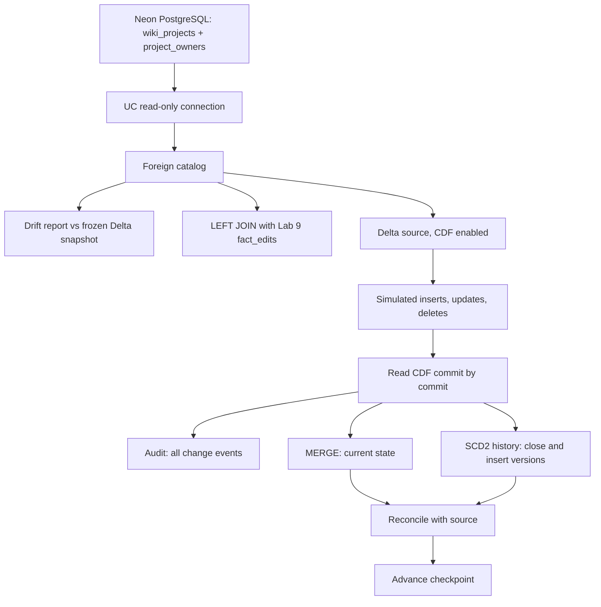

# Lab 10 - External databases: Lakehouse Federation and CDC

A Neon PostgreSQL directory of Wikimedia projects is queried in place through Lakehouse Federation and joined with the Wikipedia Gold facts from Lab 9. A dedicated Delta table with Change Data Feed then simulates inserts, updates and deletes, and an incremental pipeline keeps a current-state table and an SCD Type 2 history in sync with `MERGE INTO`.

Only Wikipedia data is used.

## Flow



Part A is the federation half (foreign catalog, comparison with Delta, join). Part B is the CDC half. The Job runs setup, federation, cdc and validate as four sequential tasks and exits successfully only when all reconciliation checks pass.

## What was built

- **External source:** schema `lab10` in Neon with `wiki_projects` (55 observed Wikimedia projects) and `project_owners` (five fictional teams). Keys match `fact_edits.wiki`.
- **Federation:** a read-only UC connection, a foreign catalog, a Delta snapshot for comparison, a drift report in both directions and a hybrid join that must keep every fact exactly once.
- **CDC:** a Delta source with Change Data Feed, a current-state table, an SCD2 history, an archive of all change events and a checkpoint table.
- **Four task notebooks:** setup, Federation, CDC and validation, each with its SQL and checks in separate cells.
- **A shared CDC library** in `src/lab10/pipeline.py`: the commit-by-commit consumer, replayable simulation and reconciliation. The notebooks and the local warehouse runner use the same code.
- **One bundle** `lab10_wikipedia_federation_cdc` with `personal` and `azure_trial_2` targets and one Job without a schedule.

PostgreSQL reference rows never change during the simulation. Part B uses the Delta CDF option of the assignment, not PostgreSQL WAL capture.

## Notebook structure

| Notebook | Responsibility |
|---|---|
| `00_setup.py` | create the Delta source with CDF, the frozen snapshots, targets and checkpoint; existing data and offsets are kept |
| `01_federation.py` | drift comparison, warm-up and timings, hybrid join and query plans |
| `02_cdc.py` | two replayable change batches, CDF consumption, captured events and intermediate SCD2 versions |
| `03_validate.py` | checks of the expected outcome, audit reconciliation and a no-op rerun |

The Job only creates data tables. The Postgres tables, the reader role, the UC connection and the foreign catalog are created outside it by `tools/seed_postgres.py` and `tools/setup_federation.py`.

## Part A: Federation

1. Compare the foreign table with a Delta snapshot taken at setup, using `EXCEPT ALL` in both directions. Source drift is reported, not treated as a failure.
2. Time the same aggregate on both paths: one warm-up per path, then three measured runs that alternate foreign and Delta. Timings and query plans are saved.
3. Join `fact_edits` with the foreign projects and owners. The join fails if a fact has no project or owner, or if rows are multiplied.

## Part B: CDC

| Step | What happens |
|---|---|
| Batch 1 | inserts fictional `lab10_demo`, changes `enwiki` owner and status, deletes `plwiki` |
| Failure test | a partial-write failure is injected; the checkpoint must not move; the same range is retried |
| Batch 2 | changes `enwiki` twice before consumption; the second update has an older business timestamp |
| Rerun | no new versions: the Job reports `NO_NEW_CHANGES` and writes nothing |

- **Commit-by-commit processing:** each CDF version is consumed in order, so intermediate SCD2 versions are kept. `enwiki` ends with four history versions (owners 4, 5, 2, 3).
- **Current state** uses inserts and update postimages; deletes remove the row.
- **SCD2** closes the current row on an update or delete and inserts a new version on an insert or update.
- **Checkpoint** is the last write, and it pins the source table ID so a recreated source cannot reuse an old offset.
- **Checks** before the checkpoint moves: source equals current at the frozen version, SCD2 current equals source, unique event and version keys, non-overlapping intervals, complete audit.

## Commands

Set `DATABASE_URL` (and optionally `DATABASE_URL_UNPOOLED`) in the ignored `lab10/.env`.

```sh
python3 -m venv lab10/.venv
lab10/.venv/bin/python -m pip install -r lab10/requirements-dev.txt

lab10/.venv/bin/python lab10/tools/seed_postgres.py      # create and fill the Neon tables, reader role
lab10/.venv/bin/python lab10/tools/setup_federation.py   # connection and foreign catalog
lab10/.venv/bin/python lab10/tools/run_dev.py            # full run through the SQL warehouse
```

| Tool | What it does |
|---|---|
| `export_projects.py` | exports observed project keys from the Lab 9 Gold tables |
| `seed_postgres.py` | transactional, additive seed (`ON CONFLICT DO NOTHING`) and a least-privilege reader role |
| `setup_federation.py` | creates the read-only connection and foreign catalog, or verifies existing ones |
| `run_dev.py` | runs setup, federation, both batches, failure recovery and the rerun, and saves a report |
| `check_job.py <run-id>` | reads one Job run and saves the task outputs |

`seed_postgres.py`, `export_projects.py` and `setup_federation.py` take `--target azure_trial_2`. Personal is the default and each target is pinned to its workspace host.

The Job:

```sh
cd lab10
databricks bundle validate --strict -t personal --profile personal-env
databricks bundle deploy -t personal --profile personal-env
databricks bundle run lab10_job -t personal --profile personal-env
```

## Safety

- The seed generates a separate Postgres reader with `SELECT` on the two tables only, and checks that it cannot write. The UC connection is `read_only`.
- Credentials stay in ignored `.env*` files and in the UC connection. They never appear in SQL history, notebooks, reports or Git.
- All writes go to a schema that ends with `lab10`, and the foreign tables are limited to an allowlist.
- Current, audit, history and checkpoint are separate Delta transactions, so writers must be serialized. A failed run is retried from the checkpoint; event and version keys make the writes replayable.
- Neon scale-to-zero makes the first query after a pause slower; the timings account for it with a warm-up.

## Targets

| Target | Workspace | Catalog | Foreign catalog | Notes |
|---|---|---|---|---|
| `personal` | Personal Free Edition, profile `personal-env` | `workspace` | `ivanrazumovskyi_lab10_neon_dev` | development mode, serverless |
| `azure_trial_2` | Azure trial 2, same workspace as Lab 8 PROD | `dbr_dev` | `ivanrazumovskyi_lab10_neon_prod` | production mode, serverless |

Both targets use the same Neon database with separate reader roles and separate connections. Creating a connection and a foreign catalog needs `CREATE CONNECTION` and `CREATE CATALOG` on the metastore. In trial 2 both objects were created through the UI; the Job only needs access to them. Production steps and the permission history are in `VALIDATION.md`.

## Results

All four Job tasks succeeded in both workspaces:

| Run | Result |
|---|---|
| [Personal, fresh schema](https://dbc-ab9a5afe-c151.cloud.databricks.com/jobs/111441949712558/runs/830705205444712) | 4/4 SUCCESS; both CDC batches applied; 653 facts joined |
| [Personal, whole-Job rerun](https://dbc-ab9a5afe-c151.cloud.databricks.com/jobs/111441949712558/runs/460363048508601) | 4/4 SUCCESS; both syncs `NO_NEW_CHANGES` |
| [Azure trial 2](https://adb-7405618361895520.0.azuredatabricks.net/jobs/67339283688658/runs/924222122408167) | 4/4 SUCCESS; existing checkpoint and targets preserved; 300 facts joined |

Every run ends at version 5 with 55 current, 59 history and 63 audit rows.

- The injected failure left the checkpoint unchanged; the retry consumed the same range.
- `enwiki` keeps four history versions, `plwiki` is gone from the current table and `lab10_demo` is inserted.
- When Neon grew from 43 to 55 projects, the drift report showed exactly 12 foreign-only rows and no snapshot-only rows, and the join still kept all 653 facts once.
- Run details and evidence files are in `VALIDATION.md` and `data/`.

## Discussion

**Federation versus ingestion.** Federation reads current data at query time and keeps no second copy, but depends on source availability, network latency and capacity, and loads the operational database. Supported filters can be pushed down. Ingestion decouples analytics from the source at the cost of storage and refresh logic, and the copy goes stale between loads. The dataset here is tiny, so the timings show the mechanics, not an engine benchmark; client time, result caching and Neon cold starts all affect them.

**Security.** Federation needs a credential for the external database, so it is a read-only role with `SELECT` on two tables, stored in a UC connection. Ingested copies also need Unity Catalog grants. For PROD, use separate credentials and connections, approved network access and workspace bindings where the metastore is shared.

**Batch versus CDC.** A full snapshot repeatedly moves unchanged rows and hides intermediate states. CDC consumes only new versions. CDF retention is finite, so consumed events are archived; if a required range has expired, the job should fail and rebuild a baseline instead of skipping versions.

**SCD and late-arriving data.** SCD1 shows only the current state; SCD2 keeps versions. History here follows commit order, and `updated_at` is a business attribute that may move backwards without discarding the correction. This does not repair business-effective intervals. Doing that would need a reliable source sequence, tie-breaking and a rebuild of affected intervals: the October 11 correction would be inserted into the past and the surrounding intervals split. A simple latest-timestamp MERGE would drop the correction and lose that history.

## GitHub Actions

| Event | What happens |
|---|---|
| Push or pull request touching `lab10/` | lint, format check and tests; no Databricks calls |
| Manual dispatch | the same local checks |

Deployment to either workspace is run by hand. CI never uses Databricks credentials.

## Project layout

| Path | What it is |
|---|---|
| `databricks.yml` | bundle variables and the `personal` and `azure_trial_2` targets |
| `resources/` | the Job with setup, federation, cdc and validate tasks |
| `src/lab10/` | shared CDC consumer, replayable simulation, reconciliation and notebook runner |
| `notebooks/` | the four Job task notebooks |
| `sql/` | Postgres schema, read-only review queries, historical admin grants reference |
| `tools/` | seed, federation setup, warehouse runner, Job report reader |
| `data/` | project key lists and compact run evidence |
| `tests/` | boundary and pipeline tests |
| `VALIDATION.md` | verified runs, run links and permission history |

The Job also reads the Lab 9 Gold fact table; it is not modified.

## Local checks

14 tests cover the write boundaries, a no-op sync without writes, commit ordering, checkpoint-last behavior, failure paths, simulation replay, the Federation drift report and checkpoint preservation during setup. The same checks run in CI:

```sh
lab10/.venv/bin/python -m ruff check lab10
lab10/.venv/bin/python -m ruff format --check lab10
lab10/.venv/bin/python -m pytest -c lab10/pyproject.toml lab10/tests
```
