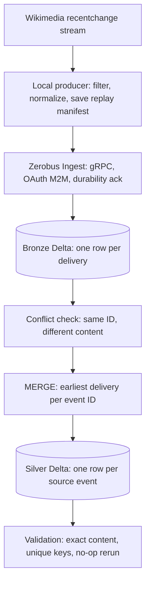

# Lab 11 - Zero-bus streaming with Zerobus Ingest

A local producer captures real Wikimedia edits and pushes them through the Zerobus Ingest SDK straight into a managed Unity Catalog Delta table. A deduplicating `MERGE` then keeps one Silver row per source event, and the design is compared with a Kafka-style architecture.

Only Wikimedia data is used.

## Flow



Ingestion is a local step because it pushes from outside Databricks. The Job processes Bronze into Silver and validates it.

## What was built

- **Producer:** captures a bounded number of real `edit` events, drops canary and non-edit records, counts malformed ones, saves a replay manifest before sending, and waits for the Zerobus durability acknowledgment.
- **Idempotency:** `event_id` is the Wikimedia `meta.id`, so it stays stable across retries, replays and producer restarts. Bronze keeps every delivery; Silver keeps one row per event.
- **Processing:** a conflict check, then a NULL-safe `MERGE` that is a no-op when Bronze has not changed. `delivery_count` records how many times an event arrived.
- **Failure checks against the real service:** invalid schema, contradictory payload, TCP break before the acknowledgment, and a late duplicate under a new run ID.
- **One bundle** `lab11_wikimedia_zerobus` with `personal` and `azure_trial_2` targets and one Job. Its notebook shows the conflict check, the `MERGE` and the result validation as separate cells, and uses only the standard library; it reads the canonical `MERGE` SQL through the `sql_root` parameter. A test keeps the notebook's SQL identical to the tested library SQL. Schema, tables and grants are created by separate commands.
- **An installable package** `src/lab11` with packaged SQL templates, a committed Wikimedia sample and offline tests, including the real `MERGE` run in DuckDB.

## Delivery and idempotency

| Layer | Guarantee | Mechanism |
|---|---|---|
| Producer | stable identity | `event_id` from the source, manifest saved before sending, `--replay` resends the same IDs |
| Zerobus | at-least-once | the acknowledgment confirms durability; the SDK recovers transient failures and may redeliver |
| Bronze | all deliveries kept | append-only, written only through Zerobus |
| Silver | one row per source event | deduplicated `MERGE`; re-running on unchanged Bronze changes nothing |

- **Durable is not queryable.** `flush()` confirms durability; validation then waits until the rows are visible.
- **Conflicts block processing.** If one event ID appears with different business content, processing stops before the `MERGE`. This scans the whole Bronze table by design, so one conflict blocks all of Silver until it is resolved.
- **Earliest delivery wins.** Missing metadata sorts last, and NULL-safe comparisons repair missing Silver metadata. `delivery_count` rises on replay while business fields stay the same.
- **Serialize processors.** A Delta primary key would not enforce uniqueness, so run one processor at a time. The Job allows one concurrent run.

## Commands

Put `ZEROBUS_CLIENT_ID` and `ZEROBUS_CLIENT_SECRET` in `lab11/.env.personal` or `lab11/.env.azure_trial_2`. Run everything from the repository root.

```sh
python3 -m venv lab11/.venv
lab11/.venv/bin/pip install -r lab11/requirements-dev.txt
lab11/.venv/bin/pip install --no-deps -e lab11

lab11/.venv/bin/python lab11/tools/check_access.py        # OAuth and service principal check
lab11/.venv/bin/python lab11/tools/setup_dev.py           # schema, tables, grants (DEV only)
lab11/.venv/bin/python -m lab11.producer --count 100 --duplicates 20 --manifest lab11/.state/run.json
lab11/.venv/bin/python lab11/tools/validate_dev.py --manifest lab11/.state/run.json --min-deliveries 120
lab11/.venv/bin/python -m lab11.producer --replay --manifest lab11/.state/run.json
lab11/.venv/bin/python lab11/tools/validate_dev.py --manifest lab11/.state/run.json --min-deliveries 220
```

Failure checks and cleanup:

```sh
lab11/.venv/bin/python lab11/tools/check_negative_dev.py
lab11/.venv/bin/python lab11/tools/check_recovery_dev.py
lab11/.venv/bin/python lab11/tools/check_late_duplicate_dev.py
lab11/.venv/bin/python lab11/tools/cleanup_negative_dev.py --suffix <12-hex suffix from the report>
```

The same scenarios run on Azure through `lab11/tools/check_azure.py validate|negative|recovery|late|cleanup`, with `--target azure_trial_2` on the producer. Use a new manifest path for each capture. `--dry-run` saves a manifest without sending, and `--replay` does not reconnect to Wikimedia.

Bundle:

```sh
cd lab11
databricks bundle validate --strict --target personal --profile personal-env
databricks bundle deploy --target personal --profile personal-env
databricks bundle run lab11_process --target personal --profile personal-env
```

## Safety

- Every target is pinned to its host. Table names are validated, and a producer table must belong to the selected target's schema.
- Bronze is written by Zerobus.
- Negative tests use their own Bronze and Silver pair, so the main tables stay clean. Cleanup takes the printed suffix and validates it.
- The recovery test shuts down only this process's TCP sockets that point at the Zerobus endpoint.
- The Azure service principal is shared, so this lab adds grants only on its own schema and tables.

## Targets

| Target | Workspace | Catalog and schema | Zerobus endpoint | Notes |
|---|---|---|---|---|
| `personal` | Personal Free Edition, profile `personal-env` (AWS `us-east-2`) | `workspace.ivanrazumovskyi_lab11_zerobus` | `7474655630219513.zerobus.us-east-2.cloud.databricks.com` | development mode, warehouse `6fec7d20a958edd1` |
| `azure_trial_2` | Azure trial 2 | `dbr_dev.ivanrazumovskyi_lab11_zerobus` | `7405618361895520.zerobus.eastus.azuredatabricks.net` | production mode, warehouse `d8b8ff9942968cb8`, serverless Job |

Zerobus accepts only OAuth credentials of a service principal that is known to the workspace. Azure uses the shared Academy service principal's Databricks OAuth secret; the Entra app key does not authenticate through this flow. An earlier Azure route went through the endpoint of the original `dbr_dev` workspace; it is no longer configured.

## Results

Both workspaces ran the same final code. Counts refer to the event IDs of a fresh manifest.

| Run | Personal | Azure trial 2 |
|---|---|---|
| Primary: 100 real events + 20 duplicates | 120 deliveries, 100 unique, Silver 100 | 120 deliveries, 100 unique, Silver 100 |
| Replay from a new producer process | 220 deliveries, Silver 100 | 220 deliveries, Silver 100 |
| Invalid BIGINT through Zerobus | `NonRetriableException`, no row inserted | `NonRetriableException`, no row inserted |
| Same ID, contradictory content | rejected before `MERGE`, Silver unchanged | rejected before `MERGE`, Silver unchanged |
| TCP break before the acknowledgment | recovered, all 100 records landed | recovered, all 100 records landed |
| Late duplicate under a new run ID | no extra Silver row, `delivery_count` +1 | no extra Silver row, `delivery_count` +1 |
| Final check | 321 deliveries, 100 unique, content equals the manifest | 321 deliveries, 100 unique, content equals the manifest |
| Repeated `MERGE` | unchanged | unchanged |
| Job | [SUCCESS](https://dbc-ab9a5afe-c151.cloud.databricks.com/jobs/870250146559587/runs/557956542483870?o=7474655630219513) | [SUCCESS](https://adb-7405618361895520.0.azuredatabricks.net/jobs/112569038788063/runs/327749431521297?o=7405618361895520) |

- Every Bronze row arrived through the Zerobus SDK; the payload of each landed row was compared with the manifest.
- These are functional acceptance runs, not throughput, latency or cost benchmarks.
- The Silver table holds more events than one run, because the smoke runs used different source events. Business uniqueness held throughout and global duplicate-key checks passed.
- Expected SDK error logs accompany the deliberate invalid payload and the TCP break.

## Discussion

| Aspect | Producer, Kafka or Event Hubs, consumer, Delta | Producer, Zerobus, Delta |
|---|---|---|
| Destination | independent consumers can write to many systems | one UC table per SDK stream |
| Decoupling | the broker separates producers from consumers | the producer depends on the lakehouse destination and its table schema |
| Replay | consumer offsets within broker retention | re-read Delta, or replay the saved source manifest |
| Buffering | broker retention absorbs consumer outages | SDK in-flight buffer and service durability; the producer persists unsent data |
| Operations | capacity, partitions, consumer jobs, lag and checkpoints | managed endpoint; you own the client, schema, auth and downstream processing |
| Cost | broker capacity, storage and network plus always-on consumer compute | ingestion, Delta storage and downstream compute |
| Fit | several independent systems need the same stream | events that belong in the lakehouse |

**Event-driven and decoupled.** A bus decouples producers from many consumers that evolve and replay independently. Zerobus does not provide Kafka's consumer-group and offset model: other readers use the Delta table, and systems outside Databricks cannot subscribe to it. Removing the bus is a good trade only when the lakehouse is the single destination.

**Fewer components.** There are no brokers, partitions or consumer jobs to run, and the table is governed by Unity Catalog from the first write. The price is a schema contract that is never evolved automatically, one destination, service-principal OAuth and supported regions only.

**Cost.** Fewer components do not prove a lower bill. The total depends on volume, retention, how many consumers would otherwise run and existing capacity.

**Reliability.** Delivery is at-least-once. Duplicates come from retries after a lost acknowledgment, so correctness comes from a stable event ID and a deterministic, re-runnable `MERGE`, not from the transport. The ingest service keeps unflushed data durable, but it runs in one availability zone.

## GitHub Actions

| Event | What happens |
|---|---|
| Push or pull request touching `lab11/` | lint, format check and offline tests |
| Manual dispatch | the same local checks |

Deployment to either workspace is run by hand.

## Project layout

| Path | What it is |
|---|---|
| `databricks.yml` | bundle variables and the `personal` and `azure_trial_2` targets |
| `resources/` | the processing Job |
| `src/lab11/` | producer, shared conflict check and `MERGE` processing, configuration |
| `src/lab11/sql/` | packaged table DDL and `MERGE` templates |
| `src/lab11/targets.json` | hosts, endpoints, schemas and warehouses per target |
| `src/lab11/fixtures/` | a small recorded Wikimedia sample for offline tests and failure checks |
| `notebooks/` | the Job's processing notebook |
| `tools/` | access checks, setup, validation, failure checks, cleanup, the Azure dispatcher and the shared environment `_acceptance.py` |
| `tests/` | offline tests |

## Local checks

Offline tests cover source mapping and filtering, error propagation when enqueue, flush or close fail, conflict gating, SQL timeout and error handling, multi-chunk results, early CLI validation, and the packaged `MERGE` run in DuckDB for duplicates, no-op reruns, late and earlier deliveries and NULL repair. They need no credentials and no `.state`; DuckDB checks do not replace the live runs above. The same checks run in CI:

```sh
lab11/.venv/bin/python -m ruff check lab11
lab11/.venv/bin/python -m ruff format --check lab11
lab11/.venv/bin/python -m pytest -c lab11/pyproject.toml lab11/tests
```
