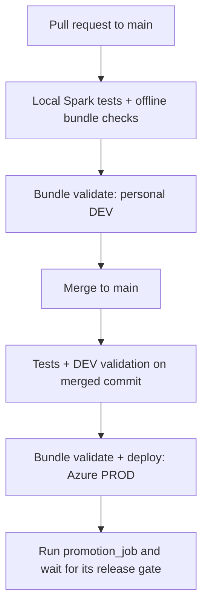

# Lab 8 - CI/CD: DEV to PROD promotion

The Wikipedia pipeline and Gold analytics from Labs 5 and 6, packaged as one Databricks Asset Bundle with two environments and a GitHub Actions workflow.
Pull requests run tests and validate DEV. A merge to `main` deploys PROD, runs the promotion Job and waits for its result.

Lab 5 parsing and quality rules and Lab 6 transformations are reused from their shared modules. Lab 8 creates its own schemas and resources. The Wikipedia producer runs on an external machine and sends events to the existing Event Hub.

## Flow



The merge is performed by the author or reviewer; CI validates the merged commit again before deploying.
PROD runs only on a qualifying push to `main`. PRs and manual workflow runs perform checks without deploying.

## What was built

- **One bundle** `lab8_wikipedia_promotion`, with `dev` in the personal workspace and `prod` in Azure trial 2. Both use serverless compute.
- **One Lakeflow pipeline:** Event Hub -> Wikipedia Bronze -> Silver and quarantine, with named expectations and preserved Kafka coordinates.
- **One eight-task Job:** setup, ingestion, Gold analytics, governance, validation and release checks.
- **Everything as code:** schemas, pipeline, Job, SQL migrations, metadata Volume, dashboard and its four queries, row filters, column mask and permissions.

The Gold model and dashboard follow Lab 6: one edit fact, five dimensions and three aggregates. The dashboard uses the viewer's own data permissions (`embed_credentials: false`). The Lab 6 alert and demo Jobs are outside this bundle. Azure infrastructure is pre-existing; Terraform is not included.

## Job

The Job `lab8-wikipedia-promotion-<target>` runs eight tasks in sequence:

```text
setup -> ingestion -> reference -> gold -> governance -> validation -> volume -> release_gate
```

| Task | What it does |
|---|---|
| `setup` | checks the migration ledger, applies new DDL, creates the metadata Volume, loads the reference snapshot and access mapping |
| `ingestion` | runs the triggered Wikipedia pipeline, without full refresh |
| `reference` | loads Wikimedia metadata and checks whether this is an initial build |
| `gold` | pins one Silver Delta version, deduplicates events, builds the fact, five dimensions and three aggregates |
| `governance` | creates policy functions, attaches row filters and the editor-name mask, grants analytical access |
| `validation` | checks unique keys, foreign keys, reconciliation, aggregate totals and attached policies |
| `volume` | records the current Gold volume against the last healthy baseline |
| `release_gate` | checks delivery completeness and repeatability, then records the successful release |

The Job has no schedule and allows one concurrent run. Empty Silver, missing policies or a failed mandatory check stop the release.
GitHub waits for the Job and fails if it fails. Gold table writes are separate operations; a failed release does not automatically roll them back.

## Release checks

```text
Bronze = Silver + Quarantine
Bronze count = distinct Kafka delivery count
Gold fact = distinct event IDs in the pinned Silver version
SUM(edit_count) of each aggregate = COUNT(fact)
```

Replayed events at different Kafka offsets remain distinct deliveries in Bronze and Silver and become one fact row per `event_id` in Gold.
Validation also checks dimension keys, fact references, byte arithmetic, aggregate byte totals and attached security policies. The gate rejects a Gold volume drop below the configured healthy baseline.

| Table | Content |
|---|---|
| `ops_schema_migrations` | applied migration names, SHA-256 checksums and timestamps |
| `ops_volume_log` | source and fact counts, healthy baseline and alert flag per run |
| `ops_releases` | run ID, deployed commit, pinned Silver version, layer counts, fact checksum and successful status |
| `ops_release_builds` | Gold build fingerprint linked to the release by run ID |

For the same Silver version and build fingerprint, the gate compares the fact count and an order-independent sum of `xxhash64` values. The fingerprint covers the Gold transformation module, shared Lab 6 and Lab 8 Python code, reference snapshot and access policy. Changed code starts a new comparison baseline. The checksum is a probabilistic check, not proof of equality.

## Repeatable deployments

- The bundle name, target and workspace root stay fixed, so deployments reuse resource IDs and deployment state. PROD uses the owner's fixed `prod_workspace_root`.
- Migrations are append-only and checksummed. Existing files cannot be edited or removed; changes go into a new migration. The runner preserves semicolons inside quotes and comments and rejects unclosed tokens before executing that file. Compound `BEGIN ... END` blocks are outside the migration format.
- Bronze has `pipelines.reset.allowed=false`, and the Job uses `full_refresh: false`. Event Hub retention must cover the checkpointed offsets; expired offsets fail with `failOnDataLoss=true`.
- DEV and PROD use separate checkpoints and different Kafka `groupIdPrefix` values.
- Volume and release records are merged by run ID. Repeated setup keeps the data and skips applied migrations.

Deployment promotes code and configuration. Each environment reads Event Hub independently, so live row counts can differ between runs. Keeping PROD changes in Git also requires restricting human write access to its resources.

## Results

Verified on 2026-10-11. All eight tasks succeeded in each run:

| Run | Bronze | Silver | Quarantine | Gold fact |
|---|---:|---:|---:|---:|
| [DEV: first successful run](https://dbc-ab9a5afe-c151.cloud.databricks.com/jobs/639631853603919/runs/964028962110402) | 1,355 | 1,355 | 0 | 1,355 |
| [DEV: repeated run](https://dbc-ab9a5afe-c151.cloud.databricks.com/jobs/639631853603919/runs/130138297309419) | 5,813 | 5,813 | 0 | 5,813 |
| [DEV: migration and release-gate fixes](https://dbc-ab9a5afe-c151.cloud.databricks.com/jobs/639631853603919/runs/408896370548989) | 16,638 | 16,638 | 0 | 16,637 |
| [PROD: Azure trial 2](https://adb-7405618361895520.0.azuredatabricks.net/jobs/534890000465235/runs/475458704371265) | 5,572 | 5,572 | 0 | 5,572 |

The latest DEV run contains one replayed event, so Gold has one fewer row than Silver. The differing capture sizes come from the live source.

- Repeated DEV setup and refresh succeeded with existing tables, policies and checkpoints. The new migration created `ops_release_builds`, and the next setup skipped it.
- Strict PROD validation and deployment succeeded. A second deployment plan returned `skip` for every resource and permission.
- All four dashboard queries succeeded on both workspaces, and both dashboards were deployed. Browser rendering has not been checked.
- The 22-test local suite passed. Offline bundle checks and the workflow checks also passed after the PAT-only CI simplification.

PROD is on the earlier verified deployment, before the migration and release-gate fixes. The remaining acceptance test is a merge to `main` that deploys the current code and finishes with a successful GitHub Actions run and matching `ops_releases.release_commit`. A same-input checksum comparison has not yet been demonstrated in the workspace because the Silver version changed between successful DEV runs.

## Project layout

| Path | What it is |
|---|---|
| `databricks.yml` | Bundle variables and the `dev` and `prod` targets |
| `resources/` | Schemas, pipeline, promotion Job, dashboard and resource permissions |
| `pipeline/` | Wikipedia Bronze, Silver and quarantine datasets |
| `notebooks/` | Job task entry points and table operations |
| `src/lab8/` | Gold builder, migration parser and ledger, release contracts and fingerprints |
| `sql/migrations/` | Append-only operational and security DDL |
| `dashboards/`, `sql/dashboard/` | Dashboard JSON and its four dataset queries |
| `assets/` | Wikimedia reference snapshot and access policy |
| `tests/` | Local pytest suite |
| `tools/` | Offline checks, GitHub CI setup and personal-workspace helpers |

The bundle also uploads `lab5/src` and `lab6/src` from the repository. Their existing tables and deployed resources are kept unchanged.

## Targets

| Target | Workspace / compute | Catalog | Schema names |
|---|---|---|---|
| `dev` | Personal Free Edition, profile `personal-env`, serverless | `workspace` | `dev_ivanrazumovskyi_ivanrazumovskyi_lab8_silver`, `dev_ivanrazumovskyi_ivanrazumovskyi_lab8_gold` |
| `prod` | Azure trial 2, profile `azure_trial_2`, serverless | `dbr_dev` | `ivanrazumovskyi_lab8_silver`, `ivanrazumovskyi_lab8_gold` |

The CLI adds the `dev_<user>_` prefix to DEV schema resources. Job parameters, the Volume path and the dashboard use the resolved names.
Bronze, Silver and quarantine live in the Silver schema; analytical, reference, security and operational tables live in Gold. Wikipedia table names keep the `_lab5` suffix for compatibility with Lab 6.

The workspace, catalog, SQL warehouse, Event Hub and secret scope must already exist. The deployment identity needs catalog/schema access, permission to create Jobs and pipelines, access to serverless compute and the warehouse, and `READ` on `lab5-eventhub / eventhub-connection-string` with Event Hub Listen permission.

From `lab8/`, deploy and test on personal DEV:

```bash
python tools/personal_cli.py bundle validate --strict
python tools/personal_cli.py bundle deploy --select jobs.promotion_job
python tools/personal_cli.py bundle run promotion_job --params release_commit=local
python tools/validate_dashboard.py
python tools/personal_cli.py bundle deploy
```

The helper reads the ignored `.env.personal` and fixes the profile to `personal-env` and the target to `dev`. The first deploy selects the Job and its dependencies; the full deploy includes the dashboard after its queries have been checked against Gold data.

## GitHub Actions

`.github/workflows/lab8-ci.yml` uses PAT authentication and three secrets:

| Where | Secret | Value |
|---|---|---|
| Repository | `DATABRICKS_DEV_TOKEN` | personal workspace access token |
| Environment `lab8-prod` | `DATABRICKS_HOST` | `targets.prod.workspace.host` from `databricks.yml` |
| Environment `lab8-prod` | `DATABRICKS_TOKEN` | access token for the verified PROD owner |

The PROD job selects Environment `lab8-prod`, which supplies its host and token. These names match the configured GitHub secrets. No additional GitHub Variables are required. The Bundle defaults supply the authenticated user's identity, management permissions, reader and PROD warehouse.

| Job | Runs on | What it does |
|---|---|---|
| `tests` | PR to `main`, relevant push to `main`, manual run | checks the bundle offline and runs pytest on local Spark |
| `validate-dev` | same-repository PR, push to `main`, manual run | configures a host-only profile and runs strict DEV validation |
| `deploy-prod` | relevant push to `main`, after both checks pass | checks the host and PAT settings, validates and deploys PROD, runs the Job with `release_commit=github.sha` and waits |

Only the deployment job references PROD secrets. Concurrent releases are queued rather than cancelled. `prod-summary.json` and `prod-run.log` are uploaded as artifacts even when a run fails.
The path filter covers Lab 8, the shared Lab 5/6 modules and this workflow. To require review before production changes, protect `main` with PR review and the two prerequisite checks. The Environment must allow `main` without required reviewers for fully automatic promotion after merge.

## Local tests

Python 3.12, Java 17 and Databricks CLI 1.10.0, from the repository root:

```bash
pip install -r lab8/requirements-ci.txt
TZ=UTC SPARK_LOCAL_IP=127.0.0.1 python -m pytest -c lab8/pytest.ini lab8/tests
python lab8/tools/check_bundle.py
```

Tests cover Wikipedia quality rules and replay deduplication, migration checksums and SQL splitting, build-scoped release checks, credential isolation and the DEV/PROD workflow boundaries. The offline checker validates the CLI resource schema, Python syntax, reference assets and consistency between dashboard SQL and JSON. Live data and governance checks run in the promotion Job.
