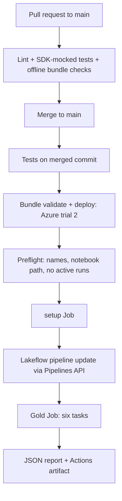

# Lab 9 - Databricks REST API automation

A Python command line tool built on the Databricks SDK that runs the Wikipedia pipeline from Labs 5-8 without the UI: it checks the target, starts each stage, waits for the exact run, and saves a JSON report.
Pull requests run tests and offline bundle checks. A merge to `main` deploys the bundle to Azure trial 2 (PROD) and runs the full sequence through the tool.

The Lab 5 parsing and quality rules, Lab 6 Gold transformations and the Lab 8 notebooks and pipeline are reused from their folders. Lab 9 creates its own schemas, pipeline and Jobs, so the Lab 5-8 deployments are untouched.

## Flow

The tool exits `0` only when every stage succeeds. A failed stage stops the sequence, and the failure is still saved in the report.

## What was built

- **One automation package** `lab9`: preflight, job and pipeline runners, a shared polling loop, cancellation and report writing.
- **One bundle** `lab9_wikipedia_automation`, with `personal` (Free Edition, serverless) and `azure_trial_2` (PROD, serverless).
- **One Lakeflow pipeline and two Jobs:** Event Hub -> Wikipedia Bronze -> Silver and quarantine; a setup Job; a six-task Gold Job.
- **Versioned reports:** each run writes a v3 JSON report with stage states, task states, notebook results, run links and durations; a JSON Schema checks its structure.
- **CI/CD:** a workflow that tests every change and, after a merge, deploys and runs the sequence on Azure trial 2.

Only Wikipedia data is used. Ingestion is started once through `pipelines.start_update` with `full_refresh=false` and is not repeated inside the Gold Job. The `lab8.*` pipeline settings and the `lab8_assets` Volume name are compatibility names of the reused code, not references to Lab 8 tables.

## Commands

| Command | What it does |
|---|---|
| `validate` | strict bundle validation for the selected target |
| `deploy` | validates, deploys and records the resource inventory |
| `inventory` | rereads Job, pipeline and notebook IDs from an existing deployment |
| `run` | full sequence: setup Job -> pipeline update -> Gold Job |
| `pipeline` | pipeline update only |
| `submit-notebook` | one-time Spark probe through `jobs.submit` |
| `status <run-id>` | reads one run without starting anything |

Personal is the default target. Azure trial 2 needs an explicit `--target azure_trial_2`. Each target has its own inventory, and a host that does not match the target is rejected.

## Safety and reliability

- **Preflight:** before any start, the tool checks that the Jobs, pipeline and notebook belong to this deployment, and that no Job run or pipeline update is already active.
- **Exact monitoring:** it follows the run ID or update ID it started, not "the latest run".
- **One deadline** covers the whole sequence. On timeout, Ctrl+C or SIGTERM, it requests cancellation of the work it started and saves a `CANCELED` or `FAILED` report. Cancellation is recorded as requested, not as verified.
- **Idempotent submission:** Job runs carry an idempotency token. Pipeline updates have none, so they are not retried.
- **Credentials** stay in the environment or an ignored file. Reports and inventories never contain them.
- **One local operation at a time** through a file lock; CI uses a concurrency group per target.

## Compute

Both targets use serverless compute: the pipeline requests serverless, and notebook tasks are submitted without a cluster specification, so Databricks provisions the compute for each run. The personal workspace is Free Edition, which does not offer classic clusters. The tool does not inspect the compute type, so reports make no compute claims. Classic cluster creation is not part of this lab.

## Targets

| Target | Workspace | Catalog | Notes |
|---|---|---|---|
| `personal` | Personal Free Edition, profile `personal-env` | `workspace` | development mode, serverless, used for branch testing |
| `azure_trial_2` | Azure trial 2, same workspace as Lab 8 PROD | `dbr_dev` | production mode, serverless, secret scope `lab5-eventhub` |

Schemas are `ivanrazumovskyi_lab9_silver` and `ivanrazumovskyi_lab9_gold`. Bronze, Silver and quarantine live in the Silver schema; analytical, reference, security and operational tables live in Gold. Jobs have no schedule and the pipeline is not continuous.

## Results

All stages succeeded in both workspaces:

| Run | Duration | Bronze | Silver | Quarantine | Gold fact |
|---|---:|---:|---:|---:|---:|
| Azure trial 2 (PROD) | 347.8 s | 300 | 300 | 0 | 300 |
| Personal | 498.2 s | 653 | 653 | 0 | 653 |

- The Gold Job passed on both: unique and foreign keys, aggregate totals, eight row filters, the editor name mask, volume baseline and the release gate.
- A repeat Azure run from the CI-style environment (token authentication) gave the same counts and exit code.
- The one-time notebook probe returned its expected Spark sum (45) on both targets.
- Row counts differ between workspaces because each reads the live source independently.

## GitHub Actions

| Event | What happens |
|---|---|
| Pull request | lint, mocked tests, offline bundle checks; no Databricks calls |
| Push to `main` | the same checks, then deploy to Azure trial 2 and run the full sequence |
| Manual dispatch | choose `azure_trial_2` (only on `main`) or `personal` (any branch) and an operation |

PROD uses the existing `lab8-prod` environment and its token; personal uses `lab9-personal`. A missing token fails before deployment and never falls back to another one. Reports and the inventory are uploaded as artifacts.

The Lab 8 workflow keeps its behavior: its merge to `main` still deploys PROD and runs the promotion Job.

## Project layout

| Path | What it is |
|---|---|
| `databricks.yml` | bundle variables and the `personal` and `azure_trial_2` targets |
| `resources/` | schemas, pipeline, setup Job and Gold Job |
| `src/lab9/` | CLI, authentication, deployment wrapper, preflight, polling and cancellation, report writer |
| `notebooks/` | `compute_probe.py`, the one-time Spark probe |
| `schemas/` | JSON Schema of the v3 report |
| `tests/` | SDK-mocked tests |
| `tools/` | offline bundle check |

The bundle also uploads `lab5/src`, `lab6/src` and the Lab 8 notebooks, pipeline, migrations and assets. Job parameters are defined once in `lab8/config/job-parameters.yml` and shared with the Lab 8 promotion Job.

## Local checks

66 tests use SDK mocks and cover failed stages, timeouts, cancellation, SIGTERM, foreign resources, report structure and the CLI. The same checks run in CI: `ruff`, `pytest` and `tools/check_bundle.py`, which validates both targets against the CLI schema without contacting Databricks.
